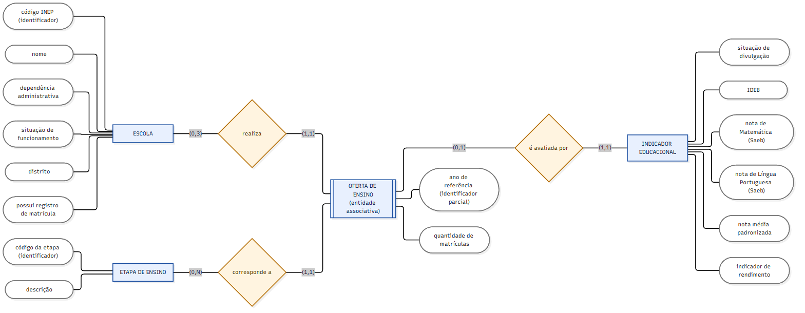

# Modelo conceitual — Educação pública no Jardim Macedônia (2025)

Este documento descreve **o que** o banco de dados precisa representar, sem se
preocupar ainda com tabelas, tipos ou comandos SQL. Fontes: Censo Escolar 2025
(microdados v2) e IDEB/Saeb 2025, ambos do Inep.

Diagrama: [der_conceitual.mmd](der_conceitual.mmd) (fonte Mermaid),
[der_conceitual.png](der_conceitual.png) e [der_conceitual.svg](der_conceitual.svg).

## 1. Conceitos básicos (com exemplos do projeto)

| Conceito | O que é | Exemplo no projeto |
|---|---|---|
| **Entidade** | Algo do mundo real sobre o qual queremos guardar informações. | A **Escola** EMEF César Yasigi. |
| **Atributo** | Uma característica de uma entidade. | O **nome** e o **código INEP** (35010281) da escola. |
| **Identificador** | Atributo (ou conjunto) que distingue uma ocorrência das demais. | O código INEP identifica uma escola; dois registros com o mesmo código são a mesma escola. |
| **Relacionamento** | Associação com significado entre entidades. | Uma escola **realiza** a oferta de uma etapa de ensino. |
| **Cardinalidade** | Quantas vezes uma ocorrência participa do relacionamento: mínimo (0 = opcional, 1 = obrigatório) e máximo (1 ou N). | Uma oferta pertence a **exatamente uma** escola (1,1); uma escola pode ter **de 0 a 3** ofertas em 2025 (0,3). |
| **Entidade associativa** | Relacionamento N:N que também tem atributos próprios e passa a ser tratado como entidade. | **Oferta de Ensino** liga Escola e Etapa e guarda a quantidade de matrículas. |

### Conceitual, lógico e físico

| Nível | Pergunta que responde | Neste projeto |
|---|---|---|
| **Conceitual** | *O que* existe e como se relaciona? | Entidades, relacionamentos e regras de negócio (este documento). |
| **Lógico** | Como organizar em tabelas relacionais? | Tabelas, PK, FK, nulidade e normalização ([modelo_logico.md](../logico/modelo_logico.md)). |
| **Físico** | Como implementar no SGBD escolhido? | Tipos e restrições do PostgreSQL 17 ([01_criacao_tabelas.sql](../fisico/01_criacao_tabelas.sql)). |

## 2. Entidades

### ESCOLA
Estabelecimento de ensino cadastrado no Censo Escolar 2025, no município de
São Paulo. É a mesma escola independentemente de quantas etapas oferece.

| Atributo | Significado |
|---|---|
| código INEP (identificador) | Código de 8 dígitos atribuído pelo Inep. |
| nome | Nome da escola no Censo. |
| dependência administrativa | Federal, estadual, municipal ou privada. |
| situação de funcionamento | Em atividade, paralisada ou extinta. |
| distrito | Divisão intramunicipal informada pelo Censo (não é bairro). |
| possui registro de matrícula | Indica se a escola aparece na Tabela de Matrícula 2025. |

### ETAPA DE ENSINO
Etapa da educação básica avaliada pelo IDEB: **anos iniciais do Ensino
Fundamental**, **anos finais do Ensino Fundamental** e **Ensino Médio**.

| Atributo | Significado |
|---|---|
| código da etapa (identificador) | Código curto definido pelo projeto (AI, AF, EM). |
| descrição | Nome da etapa, como usado na base integrada. |

### OFERTA DE ENSINO (entidade associativa)
Representa o fato de **uma escola ter alunos matriculados em uma etapa, em um
ano**. Existe somente quando a quantidade de matrículas da etapa é maior que
zero.

| Atributo | Significado |
|---|---|
| ano de referência (identificador parcial) | Ano do Censo Escolar (2025). |
| quantidade de matrículas | Número de matrículas da escola na etapa. |

Identificação: escola + etapa + ano.

### INDICADOR EDUCACIONAL
Resultado do IDEB 2025 de uma oferta (escola + etapa), com os componentes que
o formam. Depende da oferta para existir (entidade fraca).

| Atributo | Significado |
|---|---|
| situação de divulgação | Divulgado, não divulgado pelo Inep, ou escola/etapa não localizada no arquivo do Inep. |
| IDEB | Índice observado em 2025. |
| nota de Matemática (Saeb) | Proficiência média em Matemática. |
| nota de Língua Portuguesa (Saeb) | Proficiência média em Língua Portuguesa. |
| nota média padronizada | Média das notas do Saeb na escala de 0 a 10. |
| indicador de rendimento | Indicador de aprovação, de 0 a 1. |

## 3. Relacionamentos e cardinalidades

Leitura do diagrama: o rótulo **(mín,máx)** junto a uma entidade indica de
quantas ocorrências do relacionamento **uma** ocorrência daquela entidade
participa.

| Relacionamento | Lado A (mín,máx) | Lado B (mín,máx) | Leitura |
|---|---|---|---|
| ESCOLA **realiza** OFERTA | Escola (0,3) | Oferta (1,1) | Uma escola realiza de 0 a 3 ofertas em 2025 (uma por etapa). Toda oferta pertence a exatamente uma escola. |
| ETAPA **corresponde a** OFERTA | Etapa (0,N) | Oferta (1,1) | Uma etapa pode ser oferecida por várias escolas. Toda oferta é de exatamente uma etapa. |
| OFERTA **é avaliada por** INDICADOR | Oferta (0,1) | Indicador (1,1) | Uma oferta tem no máximo um resultado de IDEB 2025. Todo indicador pertence a exatamente uma oferta. |

**Participação:**

- **Escola em Oferta — opcional.** 4.776 das 7.905 escolas do recorte não têm
  matrícula em nenhuma das três etapas, por exemplo escolas só de Educação
  Infantil, escolas extintas ou escolas sem registro de matrícula.
- **Oferta em Escola e em Etapa — obrigatória.** Não existe oferta sem escola
  nem sem etapa.
- **Oferta em Indicador — opcional.** Só as ofertas de escolas públicas em
  atividade passaram pela integração com o IDEB, e as escolas privadas não têm
  IDEB por escola nos arquivos usados.
- **Indicador em Oferta — obrigatória.** Um resultado de IDEB só faz sentido
  para uma escola que oferece a etapa.

**Escola × Etapa é N:N.** Uma escola oferece várias etapas (a EE Jornalista
David Nasser oferece as três), e uma etapa é oferecida por muitas escolas.
A entidade associativa **Oferta de Ensino** resolve esse N:N e guarda o
atributo que pertence à combinação, a quantidade de matrículas, que não é da
escola nem da etapa isoladamente.

## 4. Avaliação das entidades sugeridas

| Entidade sugerida | Decisão | Justificativa |
|---|---|---|
| ESCOLA | Mantida | Corresponde à Tabela de Escola (1 linha por código INEP). |
| ETAPA_ENSINO | Mantida | Domínio fixo de 3 etapas; evita repetir a descrição em cada linha. |
| OFERTA_ENSINO | Mantida (associativa) | Granularidade escola × etapa × ano das matrículas e da integração. |
| INDICADOR_EDUCACIONAL | Mantida | Granularidade escola × etapa × ano do IDEB; é opcional para a oferta, por isso fica separada. |
| Bairro / localização | **Não criada** | Os microdados de 2025 não trazem bairro nem endereço; não se modela informação não verificada. |
| Município | **Não criada** | O recorte tem um único município (3550308); o código fica como atributo da escola. |
| Rede (IDEB) | **Não criada** | Repete a dependência administrativa do Censo (0 divergências validadas). |
| Arquivo-fonte do IDEB | **Não criada** | É determinado pela etapa e pelo ano; está documentado no dicionário de dados. |

## 5. Regras de negócio

| Código | Regra |
|---|---|
| RN01 | A escola é identificada pelo código INEP de 8 dígitos; o código é texto (identificador), não número para cálculo. |
| RN02 | A pesquisa usa **somente 2025**: cadastro e matrículas do Censo Escolar 2025 e indicadores do IDEB/Saeb 2025. |
| RN03 | O escopo geográfico é o município de São Paulo (código IBGE 3550308). |
| RN04 | Uma oferta só existe quando a etapa tem **matrícula maior que zero** na Tabela de Matrícula 2025. Matrícula igual a zero significa que a escola não oferece a etapa. |
| RN05 | Escola **sem registro** na Tabela de Matrícula 2025 tem matrícula **desconhecida**, não zero. Isso é marcado em "possui registro de matrícula". |
| RN06 | O total do Ensino Fundamental não é armazenado: é a soma de anos iniciais e anos finais (validado em 100% das escolas). |
| RN07 | Escola pública = dependência federal, estadual ou municipal. Escola em atividade = situação de funcionamento 1. |
| RN08 | O indicador educacional existe apenas para ofertas de escolas públicas em atividade (escopo da integração Censo × IDEB). |
| RN09 | A integração Censo × IDEB usa a chave **escola + etapa** (com o ano 2025); cada oferta tem no máximo um indicador. |
| RN10 | IDEB ausente **nunca** vira zero. A situação distingue "não divulgado pelo Inep" de "escola/etapa não localizada no arquivo do Inep". |
| RN11 | O IDEB está preenchido se, e somente se, a situação é "Divulgado"; nesse caso, notas do Saeb e rendimento também estão preenchidos. |
| RN12 | O indicador de rendimento pode existir sem IDEB divulgado (283 casos em 2025). |
| RN13 | As escolas do Jardim Macedônia são selecionadas por uma lista de códigos INEP de referência cadastral (ver seção 6), e não por um atributo de bairro. |

## 6. Jardim Macedônia: limitação da identificação

Os microdados do Censo Escolar 2025 **não contêm o campo de bairro**. Por isso,
o modelo **não** possui entidade, atributo ou relacionamento de bairro.

- As escolas de interesse são selecionadas por consulta, a partir da lista de
  códigos INEP documentada no pipeline (`tratamento.CODIGOS_JARDIM_MACEDONIA`).
  A lista foi obtida no cadastro do Censo Escolar 2024, a última edição com
  `NO_BAIRRO`, e é usada **apenas como referência cadastral**; nenhum dado
  analítico de 2024 é carregado.
- As escolas principais da análise são a **EMEF César Yasigi (35010281)** e a
  **EE Jornalista David Nasser (35044386)**. Elas **não representam a
  totalidade** dos estabelecimentos do bairro.
- O atributo **distrito** (por exemplo, "Capão Redondo") é uma divisão oficial
  maior que o bairro e **não** deve ser usado como sinônimo de Jardim
  Macedônia.
- Escolas novas no bairro não seriam capturadas pela lista. Uma confirmação
  futura pode usar o Catálogo de Escolas do Inep.
