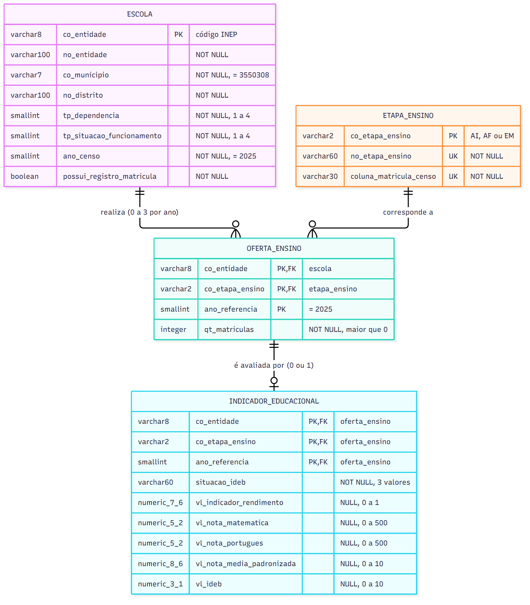

# Modelo lógico relacional — schema `educacao`

Transforma o [modelo conceitual](../conceitual/modelo_conceitual.md) em
tabelas relacionais. Os tipos abaixo são **lógicos**; os tipos exatos do
PostgreSQL 17 estão no [modelo físico](../fisico/01_criacao_tabelas.sql) e no
[dicionário de dados](../dicionario_dados.md).

Diagrama: [der_logico.mmd](der_logico.mmd), [der_logico.png](der_logico.png)
e [der_logico.svg](der_logico.svg).



## 1. PK, FK e tabela associativa (conceitos)

- **Chave primária (PK):** coluna ou conjunto de colunas que identifica cada
  linha de forma **única** e nunca é nula. Exemplo: `co_entidade = '35044386'`
  identifica a EE Jornalista David Nasser na tabela `escola`.
- **Chave estrangeira (FK):** coluna que **aponta** para a PK de outra tabela e
  garante que a referência existe. Exemplo: `oferta_ensino.co_entidade` só
  aceita códigos que existem em `escola`.
- **Chave composta:** PK formada por mais de uma coluna. Exemplo:
  `(co_entidade, co_etapa_ensino, ano_referencia)` em `oferta_ensino`.
- **Tabela associativa:** um banco relacional não representa N:N diretamente.
  A tabela `oferta_ensino` transforma "escola N:N etapa" em dois
  relacionamentos 1:N e guarda o atributo da combinação (`qt_matriculas`).
  Assim, a David Nasser aparece **uma vez** em `escola` e **três vezes** em
  `oferta_ensino`, uma por etapa. Ela continua sendo uma única escola.

## 2. Tabelas

Notação: **PK** = chave primária, **FK** = chave estrangeira, **UK** = única.

### 2.1 `escola` — uma linha por código INEP

| Coluna | Tipo lógico | Nulo | Chave | Restrição |
|---|---|---|---|---|
| co_entidade | texto(8) | não | **PK** | 8 dígitos |
| no_entidade | texto(100) | não | | |
| co_municipio | texto(7) | não | | = '3550308' |
| no_distrito | texto(100) | não | | |
| tp_dependencia | inteiro pequeno | não | | 1 a 4 |
| tp_situacao_funcionamento | inteiro pequeno | não | | 1 a 4 |
| ano_censo | inteiro pequeno | não | | = 2025 |
| possui_registro_matricula | lógico | não | | derivado |

**Por que esta PK?** O código INEP é o identificador oficial e único da escola
no Censo: há 7.905 códigos distintos em 7.905 linhas. É uma chave natural e
estável, sem necessidade de identificador artificial.

### 2.2 `etapa_ensino` — uma linha por etapa (domínio fixo)

| Coluna | Tipo lógico | Nulo | Chave | Restrição |
|---|---|---|---|---|
| co_etapa_ensino | texto(2) | não | **PK** | 'AI', 'AF' ou 'EM' |
| no_etapa_ensino | texto(60) | não | UK | descrição da base integrada |
| coluna_matricula_censo | texto(30) | não | UK | coluna de origem no Censo |

Conteúdo esperado (3 linhas):

| co_etapa_ensino | no_etapa_ensino | coluna_matricula_censo |
|---|---|---|
| AI | Anos iniciais do Ensino Fundamental | QT_MAT_FUND_AI |
| AF | Anos finais do Ensino Fundamental | QT_MAT_FUND_AF |
| EM | Ensino Médio | QT_MAT_MED |

**Por que esta PK?** Os arquivos usados não trazem um código do Inep para
essas etapas, apenas a descrição textual. Usar a descrição longa e acentuada
como chave estrangeira seria frágil, por causa de grafia e acentos. Um código
curto e legível (AI, AF, EM) é estável e autoexplicativo. Não se usa `SERIAL`
porque o domínio é fixo e conhecido: um número sequencial não teria
significado e dependeria da ordem de carga.

### 2.3 `oferta_ensino` — associativa escola × etapa × ano

| Coluna | Tipo lógico | Nulo | Chave | Restrição |
|---|---|---|---|---|
| co_entidade | texto(8) | não | **PK**, FK → escola | |
| co_etapa_ensino | texto(2) | não | **PK**, FK → etapa_ensino | |
| ano_referencia | inteiro pequeno | não | **PK** | = 2025 |
| qt_matriculas | inteiro | não | | > 0 |

**Por que esta PK?** A granularidade da tabela é "uma escola, em uma etapa, em
um ano". A combinação dessas três colunas é única: 5.984 linhas e 5.984
combinações distintas. Nenhuma coluna sozinha é única, porque uma escola
aparece até 3 vezes.

### 2.4 `indicador_educacional` — 0 ou 1 por oferta

| Coluna | Tipo lógico | Nulo | Chave | Restrição |
|---|---|---|---|---|
| co_entidade | texto(8) | não | **PK**, FK → oferta_ensino | |
| co_etapa_ensino | texto(2) | não | **PK**, FK → oferta_ensino | |
| ano_referencia | inteiro pequeno | não | **PK**, FK → oferta_ensino | = 2025 |
| situacao_ideb | texto(60) | não | | 3 valores |
| vl_indicador_rendimento | decimal | **sim** | | 0 a 1 |
| vl_nota_matematica | decimal | **sim** | | 0 a 500 |
| vl_nota_portugues | decimal | **sim** | | 0 a 500 |
| vl_nota_media_padronizada | decimal | **sim** | | 0 a 10 |
| vl_ideb | decimal | **sim** | | 0 a 10 |

**Por que esta PK?** O IDEB tem a mesma granularidade da oferta, escola +
etapa + ano. A PK é igual à FK para `oferta_ensino`, e isso implementa o
relacionamento **1 : 0..1**:

- como a PK é a FK, não existem dois indicadores para a mesma oferta;
- a FK impede que exista indicador sem oferta.

## 3. Relacionamentos e integridade referencial

| Pai (1) | Filho (N) | Cardinalidade | FK | Ação |
|---|---|---|---|---|
| escola | oferta_ensino | 1 : 0..3 (por ano) | co_entidade | ON DELETE/UPDATE RESTRICT |
| etapa_ensino | oferta_ensino | 1 : 0..N | co_etapa_ensino | ON DELETE/UPDATE RESTRICT |
| oferta_ensino | indicador_educacional | 1 : 0..1 | (co_entidade, co_etapa_ensino, ano_referencia) | ON DELETE/UPDATE RESTRICT |

Usa-se `RESTRICT` porque os dados são oficiais e a carga é controlada. Apagar
uma escola não deve apagar matrículas e indicadores "em cascata" sem que isso
seja percebido.

## 4. Ano nas chaves

O projeto usa exclusivamente 2025. Mesmo assim, `ano_referencia` faz parte das
chaves de `oferta_ensino` e `indicador_educacional`, com `CHECK (= 2025)`.

- **Rastreabilidade:** cada matrícula e cada IDEB mostra explicitamente a que
  ano se refere, e isso evita confundir o ano do Censo com o do IDEB.
- **Sem ambiguidade nas junções:** a ligação Censo × IDEB fica
  `co_entidade + etapa + ano`, igual à chave validada no pipeline.
- **Sem complexidade histórica:** o `CHECK` impede outros anos. Uma extensão
  futura exigiria apenas relaxar esse `CHECK`.

A tabela `escola` **não** tem o ano na PK. O cadastro é tratado como uma
fotografia de 2025, e `ano_censo` fica como atributo com `CHECK (= 2025)`. Uma
versão histórica exigiria separar os atributos que mudam por ano, como a
situação de funcionamento. Isso foi deixado de fora de propósito.

## 5. Ausência de matrícula × ausência de IDEB

São situações diferentes e o modelo as representa de formas diferentes:

| Situação real | Como aparece no banco | Quantidade (2025) |
|---|---|---:|
| Escola com matrícula > 0 na etapa | linha em `oferta_ensino` | 5.984 ofertas |
| Escola com matrícula **= 0** na etapa (não oferece) | **sem linha** em `oferta_ensino`, `possui_registro_matricula = TRUE` | 4.058 escolas com zero nas 3 etapas (994 públicas ativas) |
| Escola **sem registro** na Tabela de Matrícula (dado desconhecido) | sem linha em `oferta_ensino`, `possui_registro_matricula = FALSE` | 718 escolas (122 públicas ativas) |
| Oferta com IDEB divulgado | `indicador_educacional`, `situacao_ideb = 'Divulgado'`, `vl_ideb` preenchido | 2.596 |
| Oferta sem IDEB divulgado pelo Inep | `situacao_ideb = 'Não divulgado pelo Inep'`, `vl_ideb` NULL | 311 |
| Oferta não localizada no arquivo do IDEB | `situacao_ideb = 'Escola/etapa não localizada no arquivo do Inep'`, todos os valores NULL | 66 |
| Oferta fora do escopo do IDEB (privada ou não ativa) | **sem linha** em `indicador_educacional` | 3.011 |

O valor zero **não** é usado para representar ausência:

- em `oferta_ensino`, `CHECK (qt_matriculas > 0)`;
- em `indicador_educacional`, os valores ausentes ficam `NULL`.

## 6. Normalização

| Forma normal | Exigência | Situação no modelo |
|---|---|---|
| **1FN** | Valores atômicos; sem grupos repetidos. | As colunas repetidas por etapa da origem (`QT_MAT_FUND_AI`, `QT_MAT_FUND_AF`, `QT_MAT_MED`) viram **linhas** em `oferta_ensino`. |
| **2FN** | Nenhum atributo depende só de parte de uma chave composta. | `qt_matriculas` e os indicadores dependem da chave inteira (escola + etapa + ano). Nome e rede da escola, que dependem só de `co_entidade`, ficam em `escola`. O nome do arquivo do IDEB, que depende só de etapa + ano, **não** é armazenado. |
| **3FN** | Nenhum atributo não-chave depende de outro atributo não-chave. | Não há colunas derivadas: `REDE_CENSO` é derivável de `tp_dependencia` e `QT_MAT_FUND` de AI + AF. Também ficam fora `REDE_IDEB`, `NO_ESCOLA_IDEB`, `SG_UF`, `CO_MUNICIPIO` e `NO_MUNICIPIO` do IDEB, que repetem dados da escola. |

**Como a normalização ajuda a integridade.** Cada fato fica guardado em **um
só lugar**:

- o nome da David Nasser está em uma linha de `escola`, e não em três linhas
  da base integrada; se fosse corrigido, não haveria cópias divergentes;
- a descrição "Anos iniciais do Ensino Fundamental" existe uma única vez;
- a soma do Fundamental nunca fica diferente de AI + AF, porque não é
  armazenada.

**Decisões conscientes para manter a simplicidade:**

- `no_distrito` fica como atributo descritivo da escola. O código
  `CO_DISTRITO` não é carregado, o que evita a dependência transitiva
  `co_distrito → no_distrito` sem criar uma tabela de distrito.
- Os códigos de dependência e de situação ficam como `SMALLINT` com `CHECK`.
  Os significados estão no dicionário de dados, e tabelas de domínio podem ser
  criadas depois.

## 7. Correspondência com a base integrada (`CO_ENTIDADE + ETAPA_ENSINO`)

A base `escolas_publicas_sp_censo_2025_ideb_2025.csv` tem 2.973 linhas
(escola × etapa) e 27 colunas. Ela é **desnormalizada**: repete os dados da
escola em cada etapa. No modelo:

| Coluna da base integrada | Destino |
|---|---|
| CO_ENTIDADE, NO_ENTIDADE, NO_DISTRITO, TP_DEPENDENCIA, TP_SITUACAO_FUNCIONAMENTO, NU_ANO_CENSO | `escola` (uma vez por escola) |
| ETAPA_ENSINO | `etapa_ensino.no_etapa_ensino` → `co_etapa_ensino` |
| MATRICULAS_ETAPA_2025, ANO_CENSO | `oferta_ensino.qt_matriculas`, `ano_referencia` |
| INDICADOR_RENDIMENTO_2025, NOTA_MATEMATICA_SAEB_2025, NOTA_PORTUGUES_SAEB_2025, NOTA_MEDIA_PADRONIZADA_2025, IDEB_2025, SITUACAO_IDEB_2025 | `indicador_educacional` |
| QT_MAT_FUND, QT_MAT_FUND_AI, QT_MAT_FUND_AF, QT_MAT_MED | não armazenadas nesta forma; viram linhas de `oferta_ensino` (FUND = AI + AF) |
| REDE_CENSO | não armazenada (derivada de `tp_dependencia`) |
| SG_UF, CO_MUNICIPIO, NO_MUNICIPIO, NO_ESCOLA_IDEB, REDE_IDEB | não armazenadas (repetem a escola; validadas sem divergência) |
| ANO_IDEB | representado por `indicador_educacional.ano_referencia` |
| ARQUIVO_FONTE | não armazenada (determinada pela etapa; ver dicionário) |

A consulta abaixo reconstrói as 2.973 linhas da base integrada **sem
multiplicar registros**, porque cada junção segue uma FK para uma PK:

```sql
SELECT e.co_entidade, e.no_entidade, et.no_etapa_ensino,
       o.qt_matriculas, i.situacao_ideb, i.vl_ideb
FROM educacao.oferta_ensino o
JOIN educacao.escola e        ON e.co_entidade = o.co_entidade
JOIN educacao.etapa_ensino et ON et.co_etapa_ensino = o.co_etapa_ensino
JOIN educacao.indicador_educacional i
     ON  i.co_entidade     = o.co_entidade
     AND i.co_etapa_ensino = o.co_etapa_ensino
     AND i.ano_referencia  = o.ano_referencia;
```
